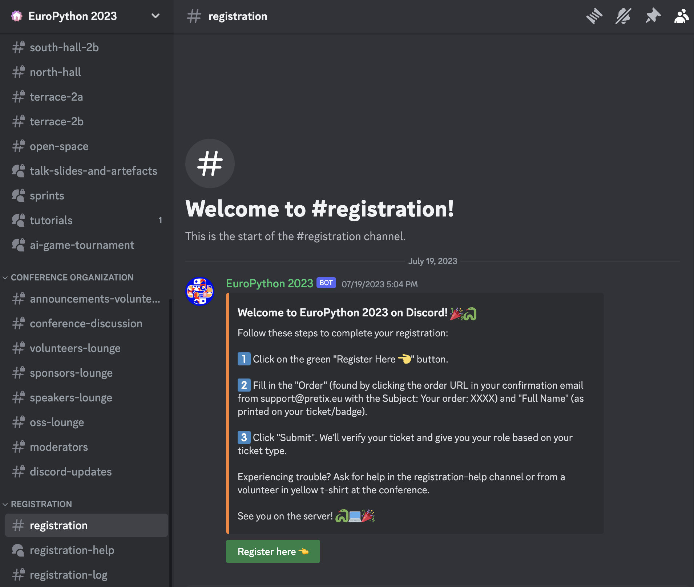

> [!NOTE]
> This is a fork from the EuroPython Discord Bot. For more information
> check [their repository](https://github.com/europython/discord).

# PyLadiesCon Discord Bot

An easy to deploy conference bot that manages roles for attendees via registration, notifies about
upcoming sessions.
Exposes Discord server statistics to organizers.

This repository is a standalone split of the `discord/` directory from
[pyladies/global-conference-infra](https://github.com/pyladies/global-conference-infra),
with full git history preserved. It was previously hosted on a Hetzner VPS;
this repo packages it for [PSF cabotage](https://github.com/cabotage/cabotage-app),
the platform that also hosts
[pyladiescon-portal](https://github.com/pyladies/pyladiescon-portal).

The bot is licensed under the MIT License (see `LICENSE`); it is a fork of the
EuroPython Discord bot and retains EuroPython's copyright notice.

## Deploying on cabotage

Cabotage builds the `Dockerfile` at the repo root and runs each `Procfile`
line as its own process. The bot is a single long-running worker with no
HTTP server, so the whole deployment is the one line in `Procfile`:

```
worker-bot: python PyLadiesBot/bot.py
```

The `worker` name prefix matters: cabotage gives `web*` processes a TLS
sidecar and expects them to serve traffic, `job*` processes require a cron
`SCHEDULE`, and `release*`/`postdeploy*` run once per deploy. `worker*` is
the plain long-running shape.

### One-time setup

1. Ask PSF infrastructure to create the project/application on
   [cabotage](https://cabotage.us-east-2.psfhosted.computer/) and install the
   cabotage GitHub App on this repository (same route as pyladiescon-portal).
2. In the cabotage application, set the two secrets as environment
   variables: `DISCORD_BOT_TOKEN` and `PRETIX_TOKEN`. The bot reads both
   from the environment; no `.secrets` file exists in the container.
3. Set the auto-deploy branch to `main`. Every merge to `main` then builds
   and deploys automatically.
4. **After the first deploy, scale `worker-bot` to exactly 1 replica.**
   New processes start at zero replicas and cabotage never scales them on
   its own, so the first deploy reports success without running the bot.
   Keep it at one replica: two bots would double-post notifications and
   race on registration.
5. In the [Discord Developer Portal](https://discord.com/developers/applications),
   under Bot > Privileged Gateway Intents, enable **Server Members Intent**
   and **Message Content Intent**. The bot requests both and will not
   connect without them.

### Runtime constraints on cabotage

- Processes run as `nobody` with only `/tmp` writable. All runtime state
  paths in `config.toml` (`registered_log.txt`, `pretix_cache.json`,
  `schedule.json`) point at `/tmp` for that reason; do not change them back
  to relative paths.
- **State is ephemeral.** `/tmp` is wiped on every deploy or restart. The
  pretix and schedule caches rebuild themselves from the APIs. The
  registered-tickets log resets, which removes the cross-restart guard
  against one ticket being redeemed twice; a future improvement is to
  rebuild it from the registration log channel at startup.
- Configuration is the committed `PyLadiesBot/config.toml` baked into the
  image. There is no `config.local.toml` override in production, so the
  real conference values (pretix URL, program API URL, channel and role
  IDs) must be committed before go-live. Channel and role IDs are not
  secrets. The currently committed values are still EuroPython 2024
  placeholders.
- `livestreams.toml` is baked into the image; changing it means a merge to
  `main` and the automatic redeploy that follows.

### Known issue

With the committed `config.toml`, the `extensions.organisers` extension
fails to load (`Roles.__init__() got an unexpected keyword argument
'volunteers_onsite'`): the `Roles` model does not accept the onsite/remote
volunteer roles defined there. The bot logs the error and keeps running.
Fix the role mapping before a real deployment, since there is no local
override file in the image.

### Running locally with Docker

```shell
docker build --tag pyladiescon-discord .
docker run --rm \
    --env DISCORD_BOT_TOKEN=$DISCORD_BOT_TOKEN \
    --env PRETIX_TOKEN=$PRETIX_TOKEN \
    pyladiescon-discord
```

The image runs as `nobody` and writes state to `/tmp`, mirroring the
cabotage runtime.



## Differences with the EuroPython bot

- This bot doesn't use ansible for the deployment step, but it's running on a VPS.
- The EuroPython conference rely on having 1-YouTube link per room per day, but PyLadiesCon
  will have 1-YouTube link per talk, so the configuration will not work out of the box.

> [!NOTE}
> Please notice that a `.secrets` and a `PyLadiesBot/config.local.toml` files are needed
> in order to make the bot work. This files are not tracked.

## TODO

- Adapt [programapi](https://github.com/EuroPython/programapi/) to generate the pretalx json files.
  This is again different from EuroPython's approach, because the pretalx configuration is different
  in both conferences.
- Adapt livestreams.toml to handle the usage of the YouTube link from the "Internal notes" field
  from pretalx,
- Adapt the `program_notification` to link Voice channels instead of youtube links

## Overview

The `main` method in `PyLadiesBot/bot.py` is the entry point for the bot. I't a good starting point
to start browsing the codebase. It requires a `.secrets` file in the root of the repository with
`DISCORD_BOT_TOKEN` and `PRETIX_TOKEN` environment variables.

### Registration

At PyLadiesCon, we use [pretix](https://pretix.eu/about/en/) as our ticketing system.

The bot utilizes the Pretix API to fetch ticket information and creates an in-memory key-value store
to retrieve the ticket type for a given Discord user. The mapping between ticket types and Discord
roles is defined in a JSON file, such as `ticket_to_roles_prod.json`, and is used by the bot to assign
roles to users.

There are safeguard methods in place to prevent users from registering multiple times and to make a
direct Pretix API call in case the user information is not available in the in-memory store.


### Program notifications

Is a service to push the programme notification to Discord. Pretalx API is used to fetch the
programme information, and `config.toml` holds information about livestream URLs.

### Organizers extension

A set of commands that are available only for organizers that are allowing to get statistics about
the Discord server.

## Setup
### Install Python, Pipenv, Pyenv (Ubuntu)
```shell
# dependencies of readline, sqlite3, ctypes
sudo apt install libreadline-dev libsqlite3-dev lzma libbz2-dev liblzma-dev

# python, pip
sudo apt install python3 python3-pip

# pyenv
curl https://pyenv.run | bash
pyenv install 3.11.4

echo 'export PYENV_ROOT="$HOME/.pyenv"' >> ~/.bashrc
echo '[[ -d $PYENV_ROOT/bin ]] && export PATH="$PYENV_ROOT/bin:$PATH"' >> ~/.bashrc
echo 'eval "$(pyenv init -)"' >> ~/.bashrc
. ~/.bashrc

# pipenv
python3 -m pip install pipenv
echo 'alias pipenv="python3 -m pipenv"' >> ~/.bashrc
. ~/.bashrc
```

### Using pipenv
This is a summary of useful pipenv commands.
Please refer to the [pipenv documentation](https://pipenv.pypa.io/en/latest/) for details.

```shell
# generate venv from Pipfile.lock
pipenv install
pipenv install --dev  # include dev dependencies

# activate pipenv-generated venv
pipenv shell

# reset all packages to versions pinned in Pipfile.lock
pipenv sync
pipenv sync --dev  # include dev dependencies

# install package and update all other packages
pipenv install package
pipenv install --dev package  # install as dev dependency

# upgrade only specific package without updating all other packages
pipenv upgrade package
pipenv upgrade --dev package  # upgrade as dev dependency

# remove package and update all other packages
pipenv uninstall package

# remove only specific packages without updating all other package
# [impossible]
```

### Clone repo, install dependencies, run tests
```shell
# clone repo, install dependencies
git clone https://github.com/pyladies/global-conference-infra/ pyladiescon-infra
cd pyladiescon-infra/discord

# install dependencies
pipenv install --dev

# run linting and tests
pipenv run black --check .
pipenv run isort --check .
pipenv run flake8 .
pipenv run pytest .
```

### Configuration
Create `config.local.toml` file in PyLadiesBot directory, it would be used instead of `config.toml`
if exists.

Add `.secrets` file to the root of the repository with the following content:
```shell
DISCORD_BOT_TOKEN=<PyLadiesConTestBotToken>
PRETIX_TOKEN=<PretixStagingToken>
````
After you have added the `.secrets` file, you can run the bot with the following command:
```shell
pipenv run python PyLadiesBot/bot.py
```
or with docker:
```shell
docker build --tag discord_bot .
docker run --interactive --tty --env DISCORD_BOT_TOKEN=$DISCORD_BOT_TOKEN --env PRETIX_TOKEN=$PRETIX_TOKEN discord_bot
```
